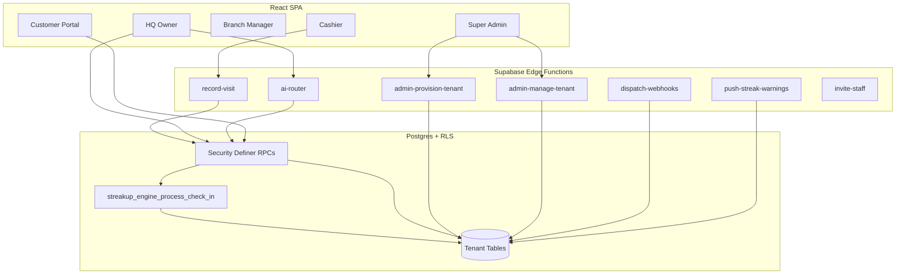

# StreakUp — Full System Audit Report

**Audit date:** 2026-05-23  
**Auditor role:** Principal Systems Auditor (read-only reconnaissance)  
**Scope:** `web/` (Vite + React), `supabase/*.sql`, `supabase/functions/*`, client types/RPC usage  
**Method:** Static analysis of repository files only — **not** a live Supabase project introspection. Deployment state on your hosted project may differ if phases were skipped.

---

## Executive summary

StreakUp is a **multi-tenant café loyalty platform** with a mature **Postgres + RLS** core, a **full streak engine** (calendar-day logic, shields, milestones, nightly auto-consume), and a **role-based React SPA** (Super Admin, HQ, Branch, Cashier, Customer portal). The system is **production-shaped** for visit ingestion, HQ operations, and tenant isolation, but has **clear half-finished product surfaces**: Web Push (backend complete, UI stubbed), Stripe billing (schema + admin assignment only, no checkout), staff invite Edge Function (no UI), and **documentation drift** (root `README.md` still references phases through 11 while the repo contains **phase25**).

| Area | Verdict |
|------|---------|
| Core streak / visit pipeline | **Done** (engine + Edge + Cashier) |
| HQ tenant dashboard | **Mostly done** (CRM, rewards, brand, dev integrations, billing read-only, ROI analytics) |
| Super Admin | **Mostly done** (tenants, audit, settings, investor analytics) |
| Customer portal | **Done** (phone-first `customer_portal_begin`, dual timers, roadmap) |
| Billing / subscriptions | **Half-baked** (DB + plan limits; no Stripe Checkout or self-serve upgrade) |
| Web Push | **Half-baked** (phase24 SQL + Edge; frontend intentionally disabled) |
| Security posture | **Strong RLS baseline** with **one notable gap**: `platform_config` readable by all authenticated roles |

---

## 1. Database & relations health check

### 1.1 SQL deployment inventory

Scripts are **manual, ordered migrations** (not Supabase CLI versioned migrations). Intended order:

| Order | File | Primary additions |
|------:|------|-------------------|
| 1 | `init.sql` | 11 core tables, enums, RLS, `record_visit_idempotent`, streak stub |
| 2 | `phase2.sql` | Auth/profile triggers, real streak engine v1, drops stub |
| 3–8 | `phase3`–`phase8` | Portal RPCs, HQ analytics, PIN allocation, staff bootstrap, pulse |
| 9 | `phase9.sql` | `platform_config`, API keys, super-admin tenant ops |
| 10 | `phase10.sql` | `plan_tiers`, `subscriptions` columns, webhooks + outbox, branding storage |
| 11 | `phase11.sql` | `free` tier, SA webhook_outbox read, pg_cron dispatcher (tail) |
| 12–25 | `phase12`–`phase25` | Lockouts, portal sessions, CRM, engine v2, push, investor/ROI analytics |

**Warning:** Root `README.md` still says “`init.sql` through `phase11.sql`” — **stale**. Operators must track applied phases manually.

### 1.2 Table catalog & foreign keys

**19 application tables** (+ `auth.users` via Supabase Auth).

```
auth.users
    └── profiles (user_id PK/FK)

cafes (tenant root)
    ├── branches (cafe_id CASCADE)
    ├── api_keys (cafe_id CASCADE)
    ├── customers (cafe_id CASCADE; auth_user_id → auth.users SET NULL)
    ├── visits (customer_id, cafe_id, branch_id RESTRICT)
    ├── reward_milestones (cafe_id CASCADE)
    ├── rewards (cafe_id, customer_id, milestone_id CASCADE)
    ├── subscriptions (cafe_id CASCADE; unique per cafe in phase10)
    ├── outbound_webhooks (cafe_id CASCADE)
    ├── webhook_outbox (outbound_webhook_id, cafe_id CASCADE)
    ├── customer_portal_sessions (cafe_id, customer_id CASCADE)
    ├── push_subscriptions (customer_id, cafe_id CASCADE)
    └── push_warning_log (customer_id, cafe_id CASCADE)

audit_log (optional cafe_id, branch_id SET NULL)
visit_idempotency_keys (cafe_id, customer_id, branch_id; visit_id SET NULL)
plan_tiers (standalone catalog, code PK)
platform_config (key PK)
auth_lockouts (standalone; no FK)
profiles (cafe_id, branch_id → cafes/branches)
```

**Referential integrity beyond FKs:** Triggers `validate_visit_scope`, `validate_reward_scope`, `validate_visit_idempotency_scope`, and `profiles_validate_branch_cafe` enforce cross-table `cafe_id` consistency where CHECK constraints cannot.

### 1.3 Broken or incomplete relations

**No orphan FK targets found** in SQL — all `REFERENCES` point to tables defined in `init.sql` or later phases.

| Finding | Severity | Notes |
|---------|----------|-------|
| `subscriptions.plan_tier` is `text`, not FK → `plan_tiers.code` | Low | Enforced by application/RPC logic, not DB constraint |
| `audit_log.actor_user_id` has no FK to `auth.users` | Low | Intentional flexibility for system actors |
| `visit_idempotency_keys` has no RLS policies | Info | RLS enabled + no policies = deny PostgREST; access via `SECURITY DEFINER` RPCs / `service_role` |

### 1.4 Orphaned / legacy database objects

| Object | Status |
|--------|--------|
| `streakup_compute_streak_after_stub()` | **Dropped** in `phase2.sql`; superseded by `streakup_engine_process_check_in` |
| `customer_portal_session(slug, phone, pin)` | **Still granted** to `anon`/`authenticated` in `phase12.sql`; **frontend uses `customer_portal_begin` only** |
| `cashier_find_customer_secure(pin, branch_code)` | **Granted** in phase12; **frontend uses `cashier_find_customer_by_pin`** (phase18) |
| `push_subscriptions`, `push_warning_log` | Active schema; **no live UI** |
| `customer_register_push_subscription` | RPC exists; **client stubbed** |

### 1.5 Row Level Security (RLS) audit

| Table | RLS | Policy summary | Risk |
|-------|-----|----------------|------|
| `cafes`, `branches`, `customers`, `visits`, `reward_milestones`, `rewards` | On | Role-scoped by `profiles` + `streakup_is_super_admin()` | Low |
| `api_keys` | On | HQ + super admin | Low |
| `profiles` | On | Self + super admin | Low |
| `audit_log` | On | **SELECT only** for scoped roles; inserts via RPC/Edge/service | Low |
| `subscriptions` | On | HQ read own; **writes super_admin only** | Low |
| `visit_idempotency_keys` | On | **No policies** → deny direct access | Low (by design) |
| `outbound_webhooks` | On | HQ scoped | Low |
| `webhook_outbox` | On | Deny all + super_admin SELECT (phase11) | Low |
| `auth_lockouts` | On | Deny all | Low |
| `push_subscriptions`, `push_warning_log` | On | Deny all | Low |
| `plan_tiers` | On | SELECT all authenticated + anon; write super_admin | Low |
| `platform_config` | On | **SELECT `using (true)` for all authenticated** | **HIGH** — see §1.6 |
| `customer_portal_sessions` | **Not enabled** | `REVOKE ALL` from `anon`/`authenticated` | Low — table not exposed via PostgREST |

**Grants note (`init.sql`):** `GRANT SELECT, INSERT, UPDATE, DELETE ON ALL TABLES … TO authenticated` — RLS must be the real gatekeeper. Tables without RLS + without REVOKE would be exposed; `customer_portal_sessions` uses explicit REVOKE.

### 1.6 Critical security warning — `platform_config`

- **Policy:** `platform_config_select_authenticated` allows **any authenticated user** to `SELECT` all rows (`using (true)`).
- **Client behavior:** `AppShell.tsx` loads **`select('key, value')` without filtering** for every logged-in session (HQ, cashier, branch manager, not only super admin).
- **Admin settings** stores `stripe_api_key` and `sms_gateway_key` in the same table (`AdminSettingsPage.tsx`).
- **Impact:** If super admin saves integration secrets, **any staff JWT can read them** via PostgREST unless mitigated outside this repo (e.g. never storing secrets there, or a hotfix policy restricting SELECT to `super_admin` only).

**Recommendation (future work):** Split secrets into Supabase Vault / Edge secrets; expose only non-secret keys to `platform_config`; or add RLS `using (streakup_is_super_admin())` for sensitive keys.

---

## 2. RPC & Edge Function inventory

### 2.1 Security-definer RPCs (tenant-facing)

| RPC | Phase | Frontend / caller |
|-----|-------|-------------------|
| `record_visit_idempotent` | init→19 | `visit-ingestion.ts` (direct); Cashier uses **Edge** `record-visit` |
| `streakup_engine_process_check_in` | 2→20 | Internal (via `record_visit_idempotent`) |
| `customer_portal_begin` | 13→22 | `MyStreakHomePage.tsx` |
| `customer_portal_session` | 3→12 | **No frontend usage** (legacy) |
| `cashier_find_customer_by_pin` | 18 | `CashierHomePage.tsx` |
| `cashier_find_customer_secure` | 12 | **Unused in web** |
| `staff_bootstrap_path` | 6 | `resolveStaffDashboard.ts` |
| `get_cafe_public_profile` | 3→10 | `BrandingHost`, `useCafePublicProfile` |
| `hq_analytics_series` | 4 | `HqAnalyticsCharts.tsx` (HQ home) |
| `hq_roi_analytics_secure` | 25 | `HqAnalyticsPage.tsx` |
| `hq_roi_ai_context` | 25 | **ai-router only** (`hq_roi_copilot`) |
| `hq_list_customers_secure` | 19→20 | `HqCustomersPage.tsx` |
| `hq_override_customer_secure` | 19→21 | `HqCustomersPage.tsx` |
| `hq_issue_api_key`, `hq_revoke_api_key` | 9–10 | `HqDevelopersPage.tsx` |
| `hq_create_outbound_webhook`, `hq_delete_outbound_webhook` | 10 | `HqDevelopersPage.tsx` |
| `streakup_plan_limits_for_cafe` | 10 | `HqBillingPage`, `HqDevelopersPage` |
| `hq_dashboard_ai_context` | 2 | **ai-router** (`hq_dashboard_insights`, `hq_owner_chat`) |
| `hq_pulse_context` | 7 | **ai-router** (`hq_live_pulse`) → `HqPulseBanner.tsx` |
| `seed_default_reward_milestones` | 16→22 | `HqRewardsPage.tsx` |
| `super_admin_set_subscription`, `super_admin_set_cafe_status` | 9–10 | Admin tenant pages |
| `admin_list_audit_secure` | 23 | `AdminAuditPage.tsx` |
| `admin_investor_analytics_secure` | 24 | `AdminAnalyticsPage.tsx` |
| `admin_audit_action_summary` | 23 | **Only called inside** `admin_list_audit_secure` |
| `customer_register_push_subscription` | 24 | **Stubbed** (`web-push-client.ts`) |
| `push_streak_warning_candidates` | 24 | **service_role** (Edge `push-streak-warnings`) |
| `nightly_shield_consume` | 19 | **pg_cron** (DB only) |
| `lockout_check` / `lockout_register_*` | 12 | Internal (portal RPCs) |
| `verify_enterprise_api_key` | 9 | **service_role** (`record-visit` Edge) |

### 2.2 Edge Functions

| Function | JWT in config | Invoked from web |
|----------|---------------|------------------|
| `record-visit` | `verify_jwt = false` (custom auth inside) | `CashierHomePage` via `recordVisitViaEdge` |
| `ai-router` | `verify_jwt = false` | HQ AI insights, pulse, owner chat, ROI copilot |
| `admin-provision-tenant` | false | `provision-tenant.ts` |
| `admin-manage-tenant` | false | `manage-tenant.ts` |
| `dispatch-webhooks` | false | **Infra only** (cron / manual POST) |
| `invite-staff` | false | **No web UI** |
| `push-streak-warnings` | (not in config.toml snippet) | **No web UI** |

---

## 3. Frontend vs backend parity (gap analysis)

### 3.1 Frontend surfaces **without** complete backend / or UI-only

| Surface | Issue |
|---------|--------|
| **HQ Billing “Upgrade” CTA** | `mailto:sales@…` only — no Stripe Checkout, no `super_admin_set_subscription` from HQ |
| **`cafes.avg_ticket_cents`** (phase25) | Drives ROI revenue estimates — **no HQ settings field** to edit; stuck at default 3500 until SQL/manual update |
| **Branch weekly schedule** (`BranchHomePage`) | Copy states hours are **illustrative** — not loaded from DB |
| **Reward “claim” flow** | `rewards.claimed_at` shown in portal roadmap; **no UI action** to claim/redeem (engine sets `earned_at` on milestone unlock only) |
| **Web Push opt-in** | `PushPermissionPrompt` returns `null`; `subscribeAndRegisterPush` returns `feature_disabled` |
| **Staff invite** | `invite-staff` Edge exists; **no HQ/Admin page** calls it |
| **Webhook dispatch** | HQ can create hooks; delivery depends on **ops** running `dispatch-webhooks` / phase11 cron — not triggered from UI |

### 3.2 Backend capabilities **without** frontend

| Backend | Gap |
|---------|-----|
| `customer_portal_session` (phone + PIN legacy) | Superseded by `customer_portal_begin`; RPC still deployable |
| `cashier_find_customer_secure` | Superseded by `cashier_find_customer_by_pin` |
| `invite-staff` Edge | No UI |
| `push-streak-warnings` + phase24 tables | UI removed/stubbed |
| `customer_register_push_subscription` | Stubbed client |
| `dispatch-webhooks` | Documented in i18n hint only |
| `nightly_shield_consume` | Cron/SQL only |
| `admin_audit_action_summary` | Embedded in audit RPC only |
| HQ **self-service** subscription tier change | **Blocked by RLS** — only `super_admin_set_subscription` |

### 3.3 Duplicate / overlapping HQ analytics

| Page | Data source |
|------|-------------|
| `/hq/:slug` (home) | `HqAnalyticsCharts` → `hq_analytics_series` (phase4) |
| `/hq/:slug/analytics` | `HqAnalyticsPage` → `hq_roi_analytics_secure` (phase25) + `TenantAICopilot` |

Both are wired and intentional but **overlap conceptually** (“analytics” on home vs dedicated ROI command center).

---

## 4. Feature module status (done vs half-baked)

### 4.1 Streak engine

| Component | Status |
|-----------|--------|
| `streakup_engine_process_check_in` | **Done** — calendar days, off-days freeze, shield on 2-day gap, same-day flag, milestone unlock + `shield_grant_amount` |
| `record_visit_idempotent` | **Done** — idempotency, audit log, propagates `already_visited_today` |
| `nightly_shield_consume` | **Done (SQL/cron)** — requires phase19 deployed + cron scheduled |
| Cashier UX for same-day | **Done** — `parseRecordVisitResponse` + `AlreadyTodayPanel` |
| Customer portal timers | **Done** — `StreakDualTimers`, `visited_today` from `customer_portal_begin` |
| Legacy stub `streakup_compute_streak_after_stub` | **Removed** in phase2 |

### 4.2 Super Admin dashboard (`/admin`)

| Module | Status |
|--------|--------|
| Overview metrics | **Done** — direct table counts |
| Tenant list / detail / provision | **Done** — Edge provision + RPC status/subscription |
| Investor analytics | **Done** — `admin_investor_analytics_secure` (needs phase24) |
| Audit log | **Done** — `admin_list_audit_secure` + filters |
| Platform settings | **Done** — `platform_config` upsert (maintenance, locale, announcement, secrets) |
| Delete tenant | **Done** — `admin-manage-tenant` Edge |

### 4.3 HQ tenant dashboard (`/hq/:slug`)

| Tab / area | Status |
|------------|--------|
| Overview + branches CRUD | **Done** |
| Brand & logo upload | **Done** — Storage `logos` + `cafes` update |
| Rewards & roadmap builder | **Done** — direct `reward_milestones` CRUD + seed RPC |
| Customers CRM + override | **Done** — phase19/20/21 RPCs |
| Integrations (API keys, webhooks) | **Done** — plan-gated RPCs |
| Billing & plan | **Half-baked** — read usage/limits; upgrade is mailto; Stripe columns display-only |
| ROI analytics + AI copilot | **Done (code)** — requires **phase25** + **ai-router** deploy with `hq_roi_copilot` intent |
| Embedded charts on home | **Done** — phase4 RPC |
| AI insights / chat on home | **Done** — ai-router |

### 4.4 Gamification (shields & rewards)

| Feature | Status |
|---------|--------|
| Shield inventory on customer | **Done** |
| Shield consume on 2-day gap (check-in) | **Done** (engine) |
| Midnight auto shield consume | **Done** (cron RPC) |
| Milestone shield grants | **Done** — `shield_grant_amount` column (phase20), not string parsing |
| `rewards` rows on unlock | **Done** (engine insert) |
| Customer-facing claim/redeem | **Not built** — display-only `claimed_at` |

### 4.5 Cashier POS (`/cashier/:branchCode`)

| Feature | Status |
|---------|--------|
| PIN lookup | **Done** — `cashier_find_customer_by_pin` |
| Visit record | **Done** — `record-visit` Edge |
| Offline queue | **Present** in `CashierHomePage` (local queue replay) |
| Same-day warning | **Done** |

### 4.6 Customer portal (`/my-streak/:slug`)

| Feature | Status |
|---------|--------|
| Phone + name onboarding | **Done** — `customer_portal_begin` |
| Session token in localStorage | **Done** |
| Roadmap / milestones | **Done** |
| Web Push | **Stubbed** (backend remains) |

### 4.7 Branch manager (`/branch/:branchCode`)

| Feature | Status |
|---------|--------|
| Visit ledger | **Done** — direct `visits` select with RLS |
| Schedule widget | **UI placeholder** — not backed by DB |

---

## 5. Billing & subscriptions — exact inventory

### 5.1 Tables & columns

**`subscriptions`** (`init.sql` + `phase10.sql`):

- `id`, `cafe_id` (FK, **unique per cafe**), `plan_name`, `status` (`subscription_status` enum), `provider` (default `'stripe'`)
- `external_id`, `current_period_end`
- **`plan_tier`** `text` default `'starter'` (not FK to `plan_tiers`)
- **`stripe_customer_id`**, **`stripe_subscription_id`** (nullable; “Stripe-ready”)

**`plan_tiers`** (`phase10.sql` + `phase11.sql`):

| code | max_branches | max_api_keys | max_outbound_webhooks | full_white_label |
|------|-------------|--------------|----------------------|------------------|
| `free` | 1 | 0 | 0 | false |
| `starter` | 1 | 0 | 0 | false |
| `growth` | 10 | 3 | 2 | false |
| `enterprise` | ∞ (-1) | ∞ | ∞ | true |

**`streakup_plan_limits_for_cafe(p_cafe_id)`** — resolves tier from latest `subscriptions.plan_tier` or defaults to `'starter'`.

**Enforcement:** `streakup_enforce_branch_plan_limit` trigger (phase10) on branch insert; HQ RPCs check limits for API keys/webhooks.

### 5.2 What billing **does not** include

- No Stripe Checkout / Customer Portal session creation in web or Edge
- No webhooks handler for Stripe subscription events
- HQ **cannot** UPDATE `subscriptions` (RLS: super_admin write only)
- No automatic provisioning of `subscriptions` row on tenant create (unless `admin-provision-tenant` does — verify in deployment; not re-audited line-by-line here)

### 5.3 Frontend billing UX (`HqBillingPage.tsx`)

- Reads: `subscriptions`, `plan_tiers`, usage counts, `streakup_plan_limits_for_cafe`
- Displays Stripe IDs if present
- Upgrade: **email mailto** only
- Super Admin assigns tier via `super_admin_set_subscription` on tenant detail/list

---

## 6. Stubs, placeholders & technical debt

| Location | Type | Description |
|----------|------|-------------|
| `web/src/components/portal/PushPermissionPrompt.tsx` | **Stub** | Returns `null`; comment “deferred” |
| `web/src/lib/push/web-push-client.ts` | **Stub** | `subscribeAndRegisterPush` → `{ ok: false, reason: 'feature_disabled' }` |
| `web/src/main.tsx` | **Dev noop** | `console.log = noop` in production build path |
| `supabase/init.sql` comment | **Historical** | References “streak engine placeholder” — superseded after phase2 |
| `README.md` | **Stale** | Documents through phase11; repo has **phase25** |
| `branch.schedule.footnote` i18n | **Explicit placeholder** | Scheduling module “when that module ships” |
| ROI revenue | **Estimated** | `avg_ticket_cents × visits` until POS integration |
| `customer_portal_session` RPC | **Legacy** | Still in DB; unused by current web |

**No widespread `TODO` / `FIXME` comments** were found in `web/src` application code (grep clean aside from UI `placeholder` attributes and PII masking comments).

---

## 7. Frontend route map (reference)

| Route | Role | Primary persistence |
|-------|------|---------------------|
| `/login` | All | Supabase Auth |
| `/admin/*` | super_admin | Tables + Edge provision/manage |
| `/hq/:slug` | hq_owner | Tables + RPCs + ai-router |
| `/hq/:slug/analytics` | hq_owner | `hq_roi_*` + ai-router |
| `/hq/:slug/billing` | hq_owner | `subscriptions`, `plan_tiers` |
| `/branch/:branchCode` | branch_manager | `visits` |
| `/cashier/:branchCode` | cashier | Edge `record-visit` |
| `/my-streak/:slug` | anon/customer | `customer_portal_begin` |

---

## 8. Critical warnings checklist

| # | Warning | Action |
|---|---------|--------|
| W1 | **`platform_config` secrets readable by any authenticated user** | Restrict RLS or stop storing secrets in JSONB |
| W2 | **Phase deployment unknown on hosted DB** | Maintain a applied-phases checklist; UI hints reference phase4/7/21/24/25 |
| W3 | **phase25 + `hq_roi_copilot` not in README** | Run `phase25.sql`; redeploy `ai-router` after pull |
| W4 | **Web Push backend live, UI off** | Re-enable only after VAPID + `sw.js` ops review |
| W5 | **Legacy RPCs still granted** (`customer_portal_session`, `cashier_find_customer_secure`) | Consider revoke to shrink attack surface |
| W6 | **Stripe columns empty in practice** | Expected until billing integration |

---

## 9. Suggested deployment verification (operator)

Run on your Supabase project (read-only checks):

```sql
-- Tables exist
select tablename from pg_tables where schemaname = 'public' order by 1;

-- Latest engine function present
select proname from pg_proc
where pronamespace = 'public'::regnamespace
  and proname in ('streakup_engine_process_check_in', 'hq_roi_analytics_secure', 'customer_portal_begin');

-- RLS enabled
select relname, relrowsecurity from pg_class
where relnamespace = 'public'::regnamespace and relkind = 'r';
```

Confirm Edge deployments: `record-visit`, `ai-router`, `admin-provision-tenant`, `admin-manage-tenant`, and optionally `dispatch-webhooks`, `push-streak-warnings`, `invite-staff`.

---

## 10. Architecture diagram (logical)



---

*End of audit report. No application code or SQL was modified during this audit.*
